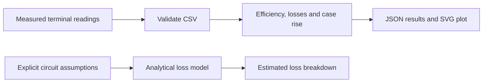

# DC–DC Converter Benchmark

[](https://github.com/sreekarseera/dc-dc-converter-benchmark/actions/workflows/checks.yml)

[Calculations](#what-the-measurement-tool-calculates) · [Run](#run-the-project) · [Loss model](#explore-the-analytical-loss-model) · [Verification](#verification-and-current-limits)

**Python tools for comparing converter measurements under defined conditions and explaining where conversion losses may come from.**

A converter's current rating or advertised peak efficiency does not tell you how it behaves at your input voltage, output setting and load. A useful comparison needs terminal measurements, a consistent test procedure and calculations that keep measured results separate from analytical assumptions.

This project provides that analysis layer for studies such as XL4015 versus MP2307 buck-converter modules. It calculates efficiency, power loss and case-temperature rise from CSV measurements, produces a readable plot, and offers a separate parameterized loss model.

## At a glance

| Item | Scope |
| --- | --- |
| Implementation | Python 3.11+, standard library only |
| Measurement input | CSV containing converter/run identifiers and electrical/temperature readings |
| Outputs | JSON results and an SVG efficiency plot |
| Analytical model | Ideal-duty CCM buck model with four explicit loss terms |
| Verification | Seven tests passing locally and on GitHub |
| Physical evidence | No raw bench dataset or independently verified converter performance is included |
| Starting point | [Measurement analysis](src/benchmark.py) · [Loss-model CLI](tools/model_losses.py) · [Test procedure](docs/methodology.md) |

This repository contains analysis software. It does not contain a new converter PCB, switching-controller firmware, closed-loop control implementation or automated electronic-load driver.

## Two questions, two separate paths



The first path answers **“What do these supplied measurements imply?”** The second answers **“What losses does this simplified model predict?”** An estimate is never automatically promoted to an experimental result.

## What the measurement tool calculates

| Output | Equation | Interpretation |
| --- | --- | --- |
| Input power | Vin × Iin | Electrical power entering the module |
| Output power | Vout × Iout | Electrical power leaving the module |
| Power loss | Input power − output power | Difference between the terminal power measurements |
| Efficiency | 100 × output power / input power | Conversion efficiency at that operating point |
| Case-temperature rise | Case temperature − ambient temperature | Observed case rise, not junction temperature |

Repeated readings are summarized only when the converter identifier, measured input voltage, measured output voltage and output current match exactly. The tool reports their mean efficiency and, for at least two repetitions, sample standard deviation.

That exact-match grouping is conservative. Slightly different measured voltages remain different groups; the software does not silently round them or merge them into a nominal operating point.

## Engineering decisions visible in the implementation

| Decision | Why it matters | Evidence |
| --- | --- | --- |
| Measure both sides of the converter | Output voltage alone cannot establish efficiency | [Measurement.result()](src/benchmark.py) |
| Reject efficiency above 100% | Expose inconsistent data instead of clipping it into a plausible result | [Input validation](src/benchmark.py) |
| Require unique converter/run pairs | Avoid accidental duplication of a measurement record | [CSV loading](src/benchmark.py) |
| Keep operating conditions separate | Avoid averaging incompatible load/voltage points | [summarize()](src/benchmark.py) |
| Plot individual points | Avoid presenting interpolation as additional measured evidence | [SVG generation](src/benchmark.py) |
| Label model outputs explicitly | Keep calculations distinguishable from observations | [loss_model()](src/benchmark.py) |
| Carry uncertainty metadata | Preserve the supplied value without claiming unimplemented error propagation | [Measurement schema](src/benchmark.py) |

These choices demonstrate inspectable measurement analysis, numerical validation, experimental comparison and data visualization. Their value is in making a result traceable—not in claiming that software tests certify a physical converter.

## Run the project

Clone the repository and run the tests:

```sh
git clone https://github.com/sreekarseera/dc-dc-converter-benchmark.git
cd dc-dc-converter-benchmark
python3 -m unittest discover -s tests -v
```

No pip packages are required.

### Analyze your measurements

Create a working file from the header-only template:

```sh
cp experiments/measurement-template.csv measurements.csv
```

The template is intentionally empty. Enter actual readings before running the analyzer; the tool rejects an empty file.

| CSV column | Unit / meaning |
| --- | --- |
| converter | Module identifier, ideally including a revision or unit label |
| run_id | Identifier unique within that converter's records |
| vin_v | Voltage measured at the input terminals, V |
| iin_a | Input current, A |
| vout_v | Voltage measured at the output terminals, V |
| iout_a | Output current, A |
| ambient_c | Ambient temperature, °C |
| case_c | Case/surface temperature, °C |
| uncertainty_pct | Supplied uncertainty metadata, from 0 to 100%; currently not propagated |

All columns are required by the CSV loader. Use finite numeric values, positive input voltage/current and nonnegative output voltage/current.

```sh
python3 src/benchmark.py measurements.csv --output output
```

| Generated file | Contents |
| --- | --- |
| output/results.json | Per-row readings and derived values, plus repeated-point summaries |
| output/efficiency.svg | Efficiency versus output current, identified by converter and input/output voltage |

The plot uses individual points with separate labels for each converter/voltage combination. Inspect the input data as well as the visual comparison.

### Understand a calculation without claiming a measurement

The unit tests include this **synthetic arithmetic example**:

| Assumed input | Value |
| --- | --- |
| Vin / Iin | 12 V / 0.5 A |
| Vout / Iout | 5 V / 1 A |
| Ambient / case | 25 °C / 40 °C |

It implies 6 W input, 5 W output, 1 W loss, approximately 83.33% efficiency and a 15 °C case rise. These numbers illustrate the calculation; they are not results from either converter module.

## Explore the analytical loss model

The optional model assumes continuous-conduction-mode operation and ideal duty ratio D = Vout / Vin. Its implemented terms are:

| Loss term | Model |
| --- | --- |
| High-side conduction | Iout² × high-side resistance × D |
| Non-synchronous freewheel | Iout × diode forward voltage × (1 − D) |
| Synchronous freewheel alternative | Iout² × low-side resistance × (1 − D) |
| Switching | ½ × Vin × Iout × combined rise/fall time × switching frequency |
| Inductor copper | Iout² × inductor DCR |

The following command uses **illustrative assumptions**, not verified specifications for an XL4015 or MP2307 module:

```sh
python3 tools/model_losses.py \
  --vin 12 --vout 5 --iout 3 \
  --frequency 180000 \
  --high-r 0.06 --low-r 0.1 \
  --diode-v 0.5 --dcr 0.02 \
  --rise-fall-ns 40
```

Frequency is in hertz, resistances in ohms, voltages in volts, current in amperes and combined rise/fall time in nanoseconds.

Without --synchronous, the freewheel term uses diode conduction; with --synchronous, it uses low-side MOSFET conduction. Both resistance arguments and the diode-voltage argument are required by the CLI even when one branch does not use them.

Output includes a loss breakdown, modeled efficiency, the label analytical_estimate_not_measurement and a list of omissions. The model excludes quiescent current, gate drive, magnetic core loss, capacitor ESR, temperature dependence and light-load/DCM control behavior. It does not compute junction temperature or predict an accurate no-load operating point.

## Make the physical comparison meaningful

The [measurement protocol](docs/methodology.md) covers the bench procedure. The main controls are:

1. **Match the intended operating conditions.** Compare at consistent input voltage, output setpoint and load, using actual terminal readings.
2. **Control the environment.** Record ambient temperature, airflow, settling criteria and the method used to measure case temperature.
3. **Record the instruments and module.** Keep ranges, uncertainty information, wiring and module revision with the raw data.
4. **Repeat measurements.** A single reading does not describe repeatability.
5. **Investigate impossible values.** An apparent efficiency above 100% can reflect timing, wiring, resolution or measurement errors; do not silently clamp it.

Use appropriately rated modules, a current-limited low-voltage supply and a suitable load. A warm case and a calculated power loss do not establish safe continuous current or junction temperature.

## Verification and current limits

Seven tests cover known efficiency/thermal arithmetic, invalid electrical values, analytical loss terms, separation of operating points, missing data, duplicate run identifiers and escaped SVG labels.

The [GitHub workflow](.github/workflows/checks.yml) runs these tests on Linux. Recorded results are in [VERIFICATION.md](VERIFICATION.md).

The tools do not acquire instruments, synchronize input/output readings, estimate uncertainty propagation or certify a converter. They also cannot verify whether a CSV row originated from an instrument. The analyst remains responsible for the measurement source and operating conditions.

No raw converter dataset is included. Future physical work should add traceable load-test records, repeatability, controlled thermal observations and comparison of modeled losses with measurements. Those remain experiments to perform, not results already established here.

## Repository guide and source record

| Path | Purpose |
| --- | --- |
| [src/benchmark.py](src/benchmark.py) | Measurement validation, calculations, summaries and plotting |
| [tools/model_losses.py](tools/model_losses.py) | Command-line analytical loss calculation |
| [experiments/measurement-template.csv](experiments/measurement-template.csv) | Header-only measurement schema |
| [tests/test_benchmark.py](tests/test_benchmark.py) | Arithmetic, validation and output tests |
| [docs/methodology.md](docs/methodology.md) | Measurement and interpretation protocol |
| [SOURCE_MANIFEST.json](SOURCE_MANIFEST.json) | Fingerprint of the supplied comparison report |

A converter comparison report was supplied, but original analysis scripts and machine-readable bench measurements were not located. This implementation was prepared with AI assistance on 29 October 2026; it is not represented as recovered historical code. See [docs/attribution.md](docs/attribution.md) and [LICENSE.md](LICENSE.md) for contribution and reuse details.
